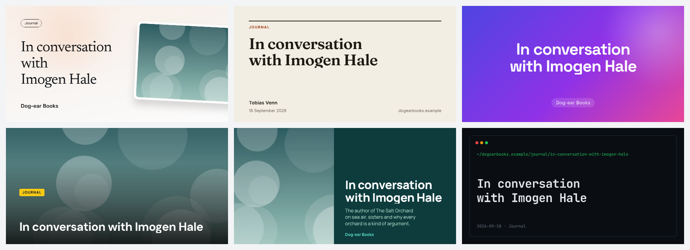
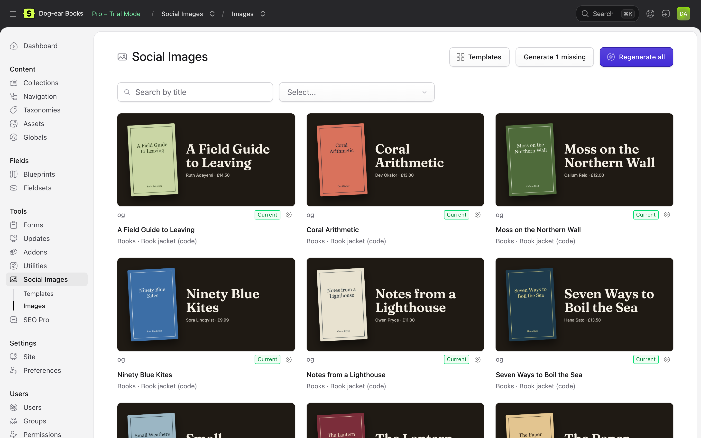
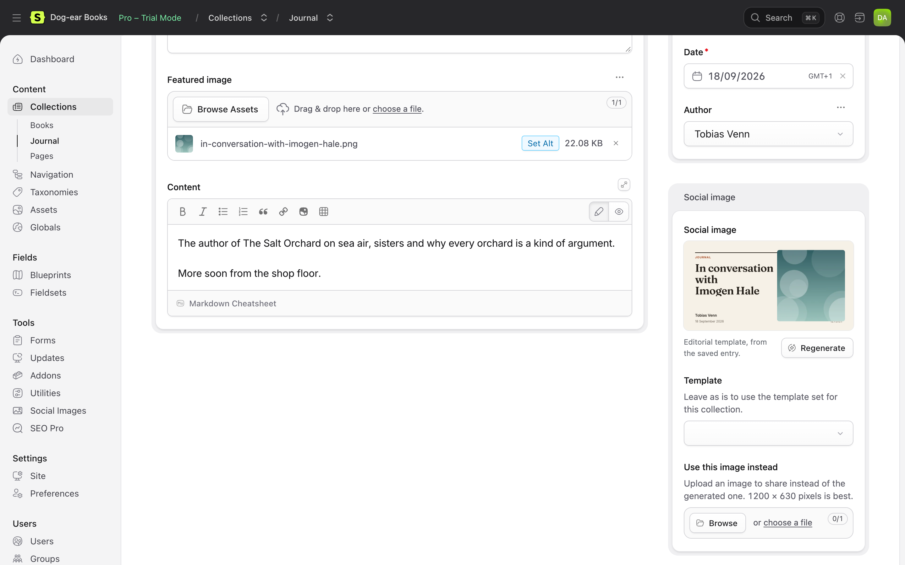

# Social Images for Statamic

Share images for every entry, made for you. Design a card once in the Control Panel, bind it to your entries' titles, photos, authors and dates, and Social Images makes a 1200 × 630 image for each entry when it's saved. Your `og:image` and `twitter:image` point at it, so links to your site look like they were designed one by one.



It works with SEO Pro, or with no SEO addon at all, and on any Statamic 6 site.

## Features

- **A visual designer in the Control Panel.** Text, images, boxes and circles on a canvas. Drag, resize and snap them; undo anything. Gradients, shadows, borders, rounded corners, rotation, opacity.
- **Bound to your entries.** Text can show any field: `{title}`, `{subtitle ?? excerpt}`, `{author:name}`, `{date:j M Y}`, `{collection:title}`, `{site:name}`. Images come from the entry's fields, with fallbacks, cropped around each asset's focal point.
- **Text that fits.** Each text layer shrinks between a largest and smallest size to fit its box, with an optional limit on lines. Long titles stay readable; short ones stay big.
- **Fonts.** Eight open-licence fonts come included. Add any Google Font (copied to your site once) or upload your own.
- **Preview with real entries.** Pick an entry and the canvas shows its title and photo. Render a real image through the same service your site uses, from the designer.
- **Every size.** Open Graph (1200 × 630) plus square, portrait, Pinterest, story or any size, each with its own layout in the same template.
- **Templates you can share.** Export a template as one JSON file, with its images and fonts inside. Import one by pasting it, uploading it, or giving its address. Six starters come with the addon, and [the gallery](gallery/README.md) has them to copy.
- **Or write your own.** Developers can use an Antlers or Blade view as a template, with the same fonts, pictures and text fitting.
- **Made in the background, only when needed.** An image is made when an entry is saved (or a page first asks for it), and only if what it shows has changed. Pages never wait: until an image exists, they use your fallback image.
- **In bulk.** Make the missing images, or remake them all, from the Control Panel or with `php please social-images:generate`. Rate limits are waited out.
- **Per collection, per entry.** Choose a template for each collection (and site), let an entry choose another, or upload an image for an entry to use instead.
- **No Chrome needed on your server.** Images are rendered with [spatie/laravel-screenshot](https://github.com/spatie/laravel-screenshot), using Browsershot (Chrome on your server) or Cloudflare Browser Rendering (no Chrome at all).

| The designer | Every entry's image | In the entry |
| --- | --- | --- |
|  |  |  |

The screenshots are from Dog-ear Books, a made-up bookshop. See [The demo](docs/demo.md).

## Requirements

- Statamic 6.35 or later, PHP 8.3 or later.
- One way to render images: Chrome or Chromium and Node.js on the server (Browsershot), or a Cloudflare account (Browser Rendering). See [Rendering](docs/rendering.md).
- Statamic Pro for Control Panel permissions. Everything else works without it.

## Installation

```bash
composer require 1994/social-images-statamic
php artisan storage:link
```

Then choose how images are rendered (see [Rendering](docs/rendering.md)): for Cloudflare, add to `.env`:

```env
LARAVEL_SCREENSHOT_DRIVER=cloudflare
CLOUDFLARE_API_TOKEN=your-token
CLOUDFLARE_ACCOUNT_ID=your-account-id
```

Make a template under **Tools → Social Images**, choose which collections use it under **Settings**, and add the **Social image** fieldset to your blueprints. If you use SEO Pro, that's it. If not, add this to your layout's `<head>`:

```antlers
{{ social_image:meta }}
```

<details>
<summary>Blade</summary>

```blade
<s:social_image:meta />
```

</details>

## Documentation

Start with [the documentation's contents](docs/README.md).

## Licence

Social Images is commercial software, sold through the [Statamic Marketplace](https://statamic.com/marketplace). You can try it free on local and staging sites; a licence is needed for each live site. See [LICENSE.md](LICENSE.md).

The included fonts are under the SIL Open Font License; each has its licence beside it in `resources/fonts`.

## Support

Ask on the addon's Marketplace page, or email [hello@1994.co.uk](mailto:hello@1994.co.uk).

## Development

```bash
composer install
npm install
npm run build        # the Control Panel's scripts
vendor/bin/phpunit   # the PHP tests
npm test             # the renderer's and designer's tests
vendor/bin/pint      # code style
```
