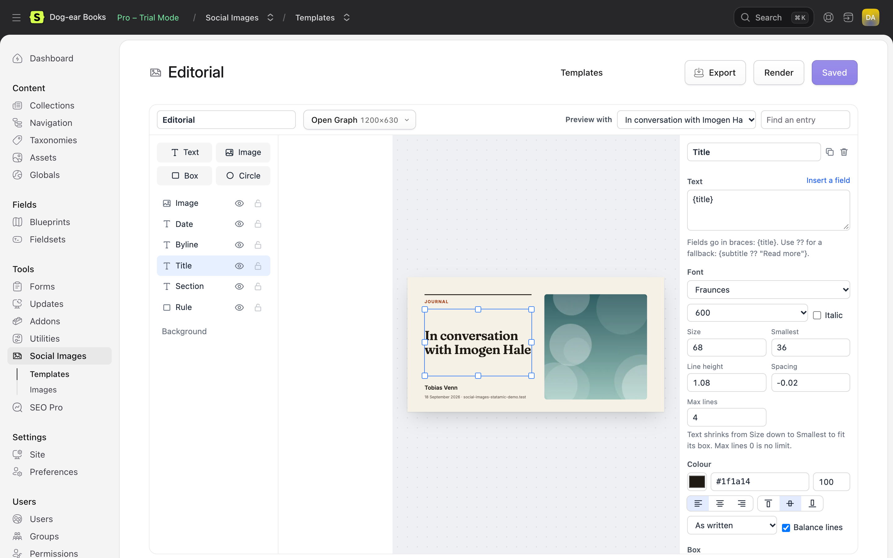

# The designer

Open a template from **Tools → Social Images**. Layers are on the left, the canvas in the middle, and the selected layer's settings on the right. Select nothing (click the canvas's surroundings, or **Background**) to change the layout's background.



The canvas is drawn by the same code that draws the real image, so what you see is what's made. To be sure, **Render** takes a real screenshot through your [rendering service](rendering.md) and shows it.

On a narrower screen the canvas goes on top, with the layers and settings beneath it.

Changes aren't saved until you choose **Save** (or press ⌘S / Ctrl+S). Leaving with unsaved changes asks first.

## Previewing with an entry

**Preview with** at the top shows the canvas with a real entry's text and pictures: choose one from the list, or type part of a title in **Find an entry** and press Enter. **Sample text** shows placeholders: "Your entry's title shows here" for `{title}`, a field's name for other fields.

Layers that would be left out for the chosen entry (a picture field it doesn't have, text with no value) are shown faded.

## Layers

Add a **Text**, **Image**, **Box** or **Circle** from the top left. The list shows the top layer first; drag a layer up or down to change what's in front. Each has a button to hide it (it's left out of the image) and one to lock it (it can't be selected on the canvas, so you can work on what's underneath).

On the canvas, drag a layer to move it, and its handles to resize it. Hold Shift on a corner to keep its proportions. Layers snap to the canvas's edges and centre and to other layers' edges, with a pink guide; hold Alt (Option) to move freely. Double-click a text layer to edit its text.

Everything works from the keyboard too: Tab to a layer in the list and press Enter to select it, then use the keys below. Alt (Option) with ↑ or ↓ on a layer in the list moves it in front or behind.

| Keys | |
| --- | --- |
| Arrows | Move the selected layer 1 pixel (Shift: 10) |
| Alt+↑, Alt+↓ | In the layer list: move the layer in front or behind |
| Delete, Backspace | Delete the selected layer |
| ⌘D / Ctrl+D | Duplicate it |
| ⌘Z / Ctrl+Z | Undo (Shift: redo) |
| ⌘S / Ctrl+S | Save |
| Escape | Select nothing |

Every layer has a position and size, a rotation and an opacity; a corner radius, border and shadow; and **Show only when**: a field that must have a value for the layer to be in the image (see [Showing layers only sometimes](#showing-layers-only-sometimes)).

## Text

Type the text, with fields in braces. **Insert a field** lists the ones your collections have.

| Write | For |
| --- | --- |
| `{title}` | The entry's title |
| `{subtitle}` | Any field, by its handle. `{field:subtitle}` works too |
| `{author:name}` | A field of the user, entry or term a field points to. `{author}` alone is the author's name |
| `{collection:title}` | The collection's title (`{collection:handle}` for its handle) |
| `{site:name}` | The site's name (`{site:url}`, `{site:locale}`) |
| `{date}` | The entry's date, as 16 October 2026 |
| `{date:j M Y}` | The date in any [PHP date format](https://www.php.net/manual/en/datetime.format.php): 16 Oct 2026 |
| `{url}` `{domain}` `{path}` | Where the entry is: its full address, its domain, its path |
| `{subtitle ?? excerpt ?? "Read more"}` | The first that has a value; the last can be words in quotes |
| `\{` | A brace, as it is |

Fields come out as plain text: formatting is removed (from Bard, Markdown and so on), entries and terms show their titles, users their names, and lists are joined with commas.

A text layer whose text comes out empty is left out of the image, so a label for a field an entry doesn't have disappears with it.

### Fitting

**Size** is the largest the text can be, and **Smallest** the smallest. The text starts at Size and shrinks until it fits its box: in height, in the width of its longest word, and in **Max lines** if you set it (0 is no limit). If it still doesn't fit at the smallest size, it's cut at the last whole word that fits, with an ellipsis (…). Short titles stay big, long ones get smaller, and nothing spills out.

**Balance lines** evens out the lines' lengths, so a title doesn't end with one word on its own.

### Labels and pills

Turn on **Fit the box to the text** and give the layer a background (and perhaps a border and a large corner radius): the background hugs the words, like a label or a pill, and the padding is around them. The layer's box is then just where the label sits, and **Align** says which side it sits on.

## Images

Under **Picture**, list where the picture comes from. The first that has one is used:

- **Add a field**: an assets field of the entry (`featured_image`), or of something a field points to (`author.avatar` for a user's avatar).
- **Upload an image**: a fixed picture, like your logo or a texture. It's kept with your templates, in `resources/social-images/uploads`.

So a list of *Field: hero_image*, *else Field: featured_image*, *else Uploaded image* uses the entry's hero image, or its featured image, or your default picture.

**Fill the box** crops the picture to the layer's box, keeping the asset's focal point in view (set it in the asset's editor). **Fit inside the box** shows all of it. Pictures are resized to the size they're drawn at before they go into the page, so a 20 MB photo costs nothing.

An image layer with no picture for an entry is left out.

## Boxes and circles

Shapes for backgrounds, cards, rules and blobs. Fills can be a colour, or a linear or radial gradient of two to eight colours. Every colour has an opacity. **Blur** softens a shape into a glow.

## The background

With nothing selected, choose the layout's background: a colour or a gradient. For a photo filling the whole image, add an image layer the size of the canvas.

## Fonts

The font list has the eight that come with Social Images (Inter, DM Sans, Manrope, Space Grotesk, Fraunces, Playfair Display, Newsreader, JetBrains Mono, each in a range of weights) and any you've added. To add one, choose **Add a font…** at the bottom of the list:

- **Google Fonts**: type its name as on [fonts.google.com](https://fonts.google.com) and tick the weights. It's copied to your site (Latin and Latin Extended characters) and never fetched from Google again.
- **Upload**: a WOFF2, WOFF, TTF or OTF file, with its name, weight and style. Upload each weight and style you want. Check your font's licence allows it to be used in images.

Fonts you add are kept in `resources/social-images/fonts`, so they go wherever your site goes.

## Showing layers only sometimes

**Show only when** takes a field, or fields joined with `??`: the layer is in the image only when one of them has a value. For example, a dark gradient behind a photo, shown only when there's a photo:

```
featured_image ?? hero_image
```

Text and image layers already leave themselves out when they have nothing to show; this is for the shapes that go with them.

## Sizes

The size menu at the top (it shows the one you're working on) lists the template's layouts and switches between them. Every template has **Open Graph** (1200 × 630). **Add a size…** in the menu adds another: Square (1080 × 1080), Portrait (1080 × 1350), Pinterest (1000 × 1500), Story (1080 × 1920), or any size from 200 to 2400 pixels each way. A new size starts as a copy of the Open Graph layout, scaled to fit; then arrange it as it should be. Each size has its own layers. **Remove** in the same menu deletes the size you're on (Open Graph can't be removed).

Which sizes are made, and when, is up to the [settings](choosing-templates.md#sizes).

## Exporting

**Export** downloads the template as one JSON file, with its uploaded pictures and your own fonts inside it. See [Importing and exporting](importing.md).
