# Template gallery

Templates for [Social Images](../README.md), to import into your site. Each is the same as the starter of the same name that comes with the addon.

To use one: in the Control Panel, go to **Tools → Social Images → Import → Address** and paste its address. Or download the file and import it from **File**, or open it and paste its JSON. See [Importing and exporting](../docs/importing.md).

Pictures come from a field called `featured_image`, `image`, `hero_image`, `cover_image`, `photo` or `thumbnail`. Some templates also show fields like `{excerpt}`, `{author}`, `{price}`, `{location}`, `{client}` or `{quote}`, and leave them out when an entry doesn't have them. If your fields have other names, change them in the designer after importing.

| | |
| --- | --- |
|  **Bold gradient**: a bright gradient, a big centred title and the site’s name. Needs no photos. `https://raw.githubusercontent.com/1994limited/social-images-statamic/main/gallery/bold-gradient.json` | 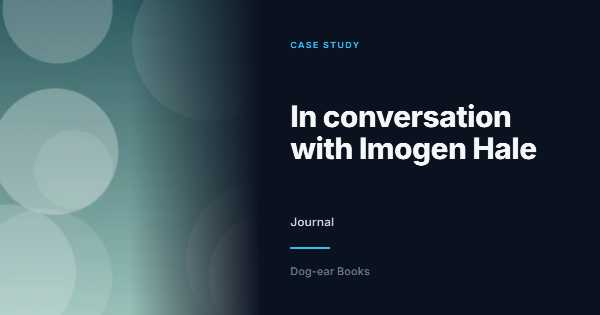 **Case study**: a photo fading into midnight blue, the project’s title and the client (from a client field, or the collection). For agencies and portfolios. `https://raw.githubusercontent.com/1994limited/social-images-statamic/main/gallery/case-study.json` |
| 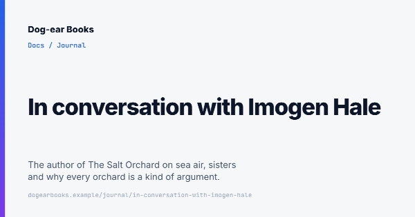 **Docs**: a clean page with a breadcrumb, a bold title, a summary and the page’s address. For documentation and guides. `https://raw.githubusercontent.com/1994limited/social-images-statamic/main/gallery/docs.json` | 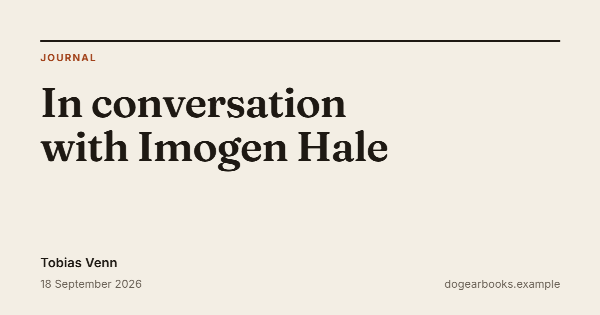 **Editorial**: a large serif headline on paper, with the author and date beneath. Good for articles and journals. `https://raw.githubusercontent.com/1994limited/social-images-statamic/main/gallery/editorial.json` |
| 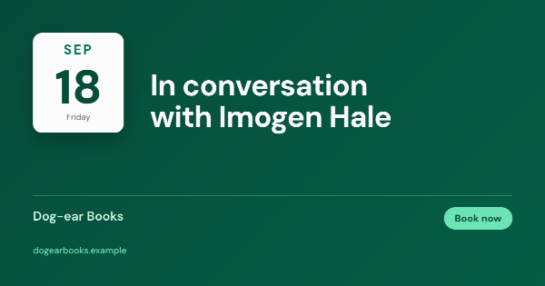 **Event**: a calendar card with the entry’s date, the title, where it is and a button. For events, talks and launches. `https://raw.githubusercontent.com/1994limited/social-images-statamic/main/gallery/event.json` | 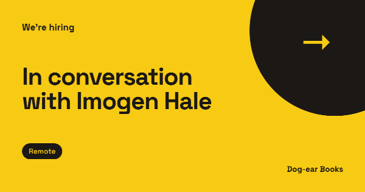 **Hiring**: bold yellow, “We’re hiring”, the role and where it is (a location field, or Remote). For job listings. `https://raw.githubusercontent.com/1994limited/social-images-statamic/main/gallery/hiring.json` |
|  **Magazine**: a magazine cover: the photo full size, the site’s name as the masthead and the title as the cover line. `https://raw.githubusercontent.com/1994limited/social-images-statamic/main/gallery/magazine.json` | 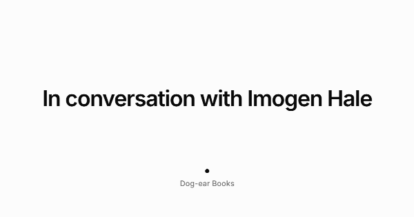 **Minimal**: just the title, centred in black on white, with the site’s name. Goes with anything. `https://raw.githubusercontent.com/1994limited/social-images-statamic/main/gallery/minimal.json` |
|  **Newsroom**: a red section label, a bold serif headline and the photo alongside. For news and announcements. `https://raw.githubusercontent.com/1994limited/social-images-statamic/main/gallery/newsroom.json` |  **Photo overlay**: the entry’s photo fills the image, darkened at the bottom under a white title. `https://raw.githubusercontent.com/1994limited/social-images-statamic/main/gallery/photo-overlay.json` |
| 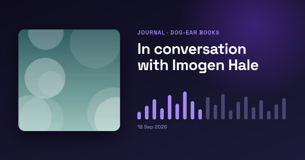 **Podcast**: episode artwork, the title and a sound wave on deep purple. For shows, episodes and audio. `https://raw.githubusercontent.com/1994limited/social-images-statamic/main/gallery/podcast.json` | 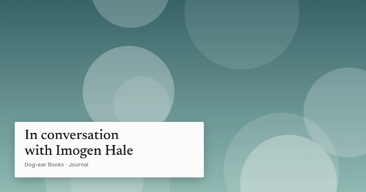 **Portfolio**: the photo, full size, with a small white caption card. For photography, art and design work. `https://raw.githubusercontent.com/1994limited/social-images-statamic/main/gallery/portfolio.json` |
| 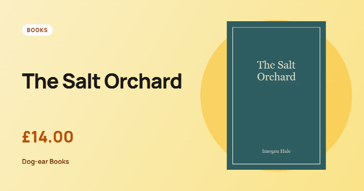 **Product**: the product’s picture on a sunny blob, its name and its price (from a price field, if it has one). For shops. `https://raw.githubusercontent.com/1994limited/social-images-statamic/main/gallery/product.json` | 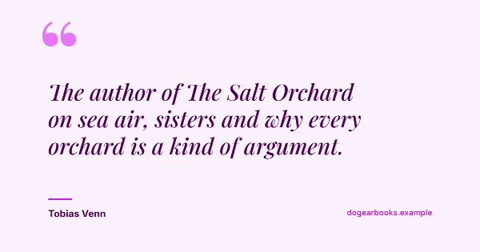 **Quote**: a big italic quote (from a quote field, else the excerpt or title) with who said it. For testimonials, interviews and essays. `https://raw.githubusercontent.com/1994limited/social-images-statamic/main/gallery/quote.json` |
| 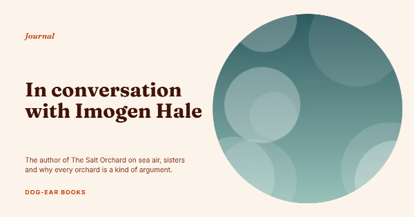 **Recipe**: a rounded photo, an italic kicker and a warm serif title. For recipes, food and lifestyle writing. `https://raw.githubusercontent.com/1994limited/social-images-statamic/main/gallery/recipe.json` | 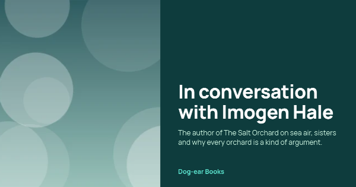 **Split**: photo on the left, title and summary on the right, on a colour of your choosing. `https://raw.githubusercontent.com/1994limited/social-images-statamic/main/gallery/split.json` |
| 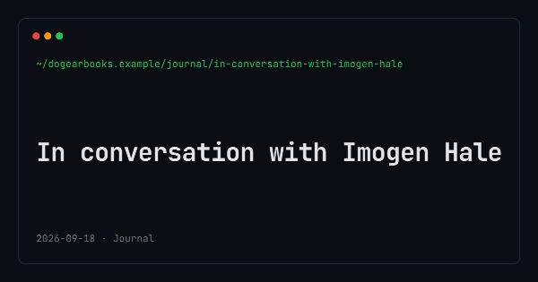 **Terminal**: monospaced type on near-black, with the page’s address as a prompt. For developer blogs and docs. `https://raw.githubusercontent.com/1994limited/social-images-statamic/main/gallery/terminal.json` |  |

The previews show a post (and, for Product, a book) from [the demo](../docs/demo.md).

Made a template you'd like to share? Export it and send it to [hello@1994.co.uk](mailto:hello@1994.co.uk).
